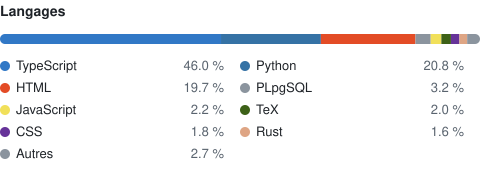

# Bastien Gaffet

Étudiant en classe préparatoire scientifique. Je construis des outils dont je me sers vraiment : applications, automatisation, infrastructure de serveur, et parfois des machines.

[bastiengaffet.fr](https://bastiengaffet.fr) &nbsp;·&nbsp; [Equiliz](https://equiliz.bastiengaffet.fr) &nbsp;·&nbsp; [Krino](https://github.com/Bastien-Gaffet/krino)

 

### Projets

<table>
  <tr>
    <td width="50%" valign="top">
      <a href="https://equiliz.bastiengaffet.fr"><b>Equiliz</b></a> 
      React · Hono / tRPC · Drizzle · MariaDB
      
Partage de dépenses entre proches. Groupes, invitations par lien ou QR code, remboursements, version Android en préparation. En ligne en bêta.

    </td>
    <td width="50%" valign="top">
      <a href="https://github.com/Bastien-Gaffet/krino"><b>Krino</b></a> 
      Tauri 2 · Rust · TypeScript
      
Trier sa photothèque d'un geste. Application de bureau Windows : tri par mois façon swipe, galerie, albums, doublons, rangement par date.

    </td>
  </tr>
  <tr>
    <td width="50%" valign="top">
      <a href="https://github.com/Bastien-Gaffet/cdp-scraper"><b>cdp-scraper</b></a> 
      Python · CLI
      
Sauvegarder ses propres documents de cours depuis cahier-de-prepa.fr, en une commande.

    </td>
    <td width="50%" valign="top">
      <a href="https://github.com/Bastien-Gaffet/Robot_J4"><b>Robot J4</b></a> 
      Python · Arduino · Minimax
      
Bras robotique qui joue au Puissance 4 contre un humain. Conception mécanique, logique de jeu et pilotage moteur.

    </td>
  </tr>
</table>

 

### En privé

Une bonne partie de mon travail vit dans des dépôts privés : des applications que je prépare pour les stores, et l'infrastructure d'un serveur que j'administre.

- **Kairoo** : application mobile d'heures miroir. Mon plus gros projet en nombre de commits. React Native · Expo · Supabase
- **Orbit Pixel** : tracker d'habitudes en pixel art pensé pour la routine de prépa, avec application Android et API de synchronisation. Expo · Hono · MariaDB
- **PrepaTrack** : suivi de prépa et simulateur de résultats aux concours (Mines-Ponts, Centrale-Supélec, X-ENS, CCINP). React · Supabase
- **Tourny** : gestion de tournois sportifs pour les clubs, né pour un club de volley. Web · Flutter · Firebase
- **Double Time** : application de notifications aux heures doubles, avec succès et points. Flutter
- **Serveur Minecraft communautaire** : tout l'écosystème est fait maison. Plugins Paper, bot Discord qui synchronise comptes et grades, panel web et son API, CreeperGPT (un assistant IA en jeu limité à une liste blanche de commandes) et un kit de migration du VPS. La mise en veille automatique des serveurs, [reveilleur](https://github.com/Bastien-Gaffet/reveilleur), est publique. Java · Python · Rust · nginx

 

### Outils

 

### Activité récente

<!-- ACTIVITY:START -->
- <a href="https://github.com/Bastien-Gaffet/onde"><b>onde</b></a> &middot; il y a 3 jours &middot; <a href="https://github.com/Bastien-Gaffet/onde/commit/ea02564c6b80924f39cd810a26f27437da800538"><code>docs: README clair avant publication</code></a>
- <a href="https://github.com/Bastien-Gaffet/Hiveheart"><b>Hiveheart</b></a> &middot; il y a 3 jours &middot; <a href="https://github.com/Bastien-Gaffet/Hiveheart/commit/0be868e451cee0f653e4b67940d048c12d61f401"><code>docs: README clair avant publication</code></a>
- <a href="https://github.com/Bastien-Gaffet/driver-imprimante"><b>driver-imprimante</b></a> &middot; il y a 3 jours &middot; <a href="https://github.com/Bastien-Gaffet/driver-imprimante/commit/f0b9c0230b4dbc855a7bfe4afcc3e47e8c9688a5"><code>docs: README clair avant publication</code></a>
- <a href="https://github.com/Bastien-Gaffet/anotrack"><b>anotrack</b></a> &middot; il y a 3 jours &middot; <a href="https://github.com/Bastien-Gaffet/anotrack/commit/124e29109cf3632a51e9ccc585cd0c7b8ff33696"><code>docs: README clair avant publication</code></a>
- <a href="https://github.com/Bastien-Gaffet/reveilleur"><b>reveilleur</b></a> &middot; il y a 3 jours &middot; <a href="https://github.com/Bastien-Gaffet/reveilleur/commit/98b0a68549f8dc1a5c065f9a40cfd7d0552c4520"><code>Fins de ligne LF forcées (scripts exécutés sous Linux)</code></a>
<!-- ACTIVITY:END -->

 

 

<picture>
  <source media="(prefers-color-scheme: dark)" srcset="https://raw.githubusercontent.com/Bastien-Gaffet/Bastien-Gaffet/output/snake-dark.svg">
  
</picture>

<!-- STATS:START -->
18 dépôts publics &middot; 18 privés &middot; 5 étoiles &middot; mis à jour automatiquement le 18 oct. 2026
<!-- STATS:END -->
